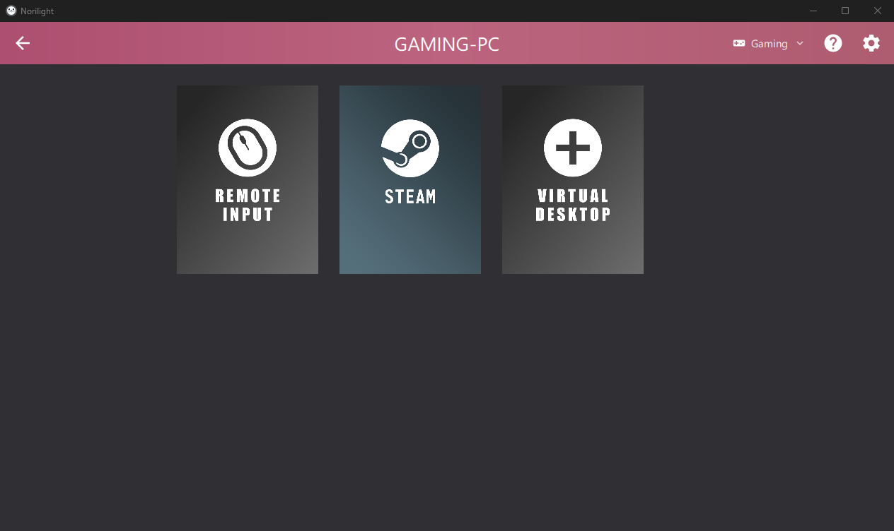
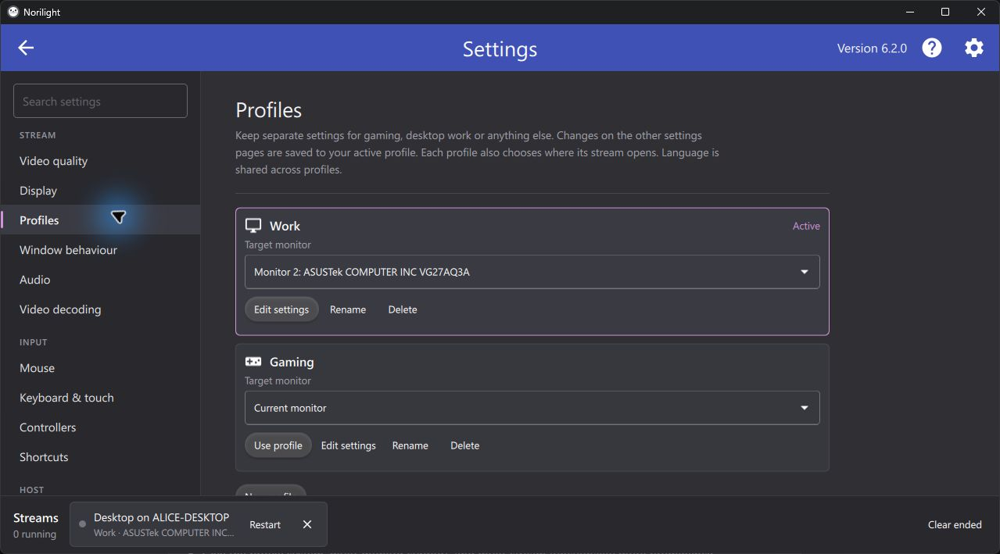
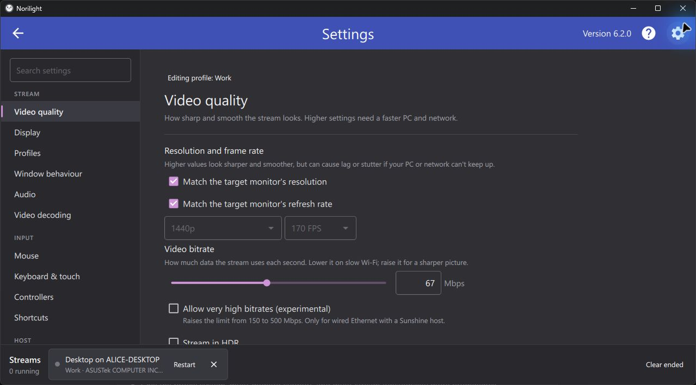

<p align="center">
  
</p>

<h1 align="center">Norilight</h1>

<p align="center">The cutest Moonlight client ε(　꜆´ω`)꜆ for desktop users and gamers alike.</p>

Norilight is a fork of [Moonlight PC](https://github.com/moonlight-stream/moonlight-qt)
that makes switching between gaming and remote desktop work easier. Save each setup
as a profile, choose the monitor it opens on, and manage multiple stream windows
without closing the main app.

It connects to [Sunshine](https://github.com/LizardByte/Sunshine),
[Apollo](https://github.com/ClassicOldSong/Apollo), and existing NVIDIA GameStream hosts.
Moonlight's streaming foundation stays underneath; Norilight adds profiles, monitor
selection, searchable settings, and desktop controls around it. Apollo-specific extras
require Apollo on the host.

<p align="center">
  <a href="https://github.com/azijnwater/Norilight/releases/tag/nightly">Download nightly</a> ·
  <a href="#profiles-monitors-and-streams">Profiles and monitors</a> ·
  <a href="BUILDING.md">Build from source</a> ·
  <a href="#roadmap">Roadmap</a>
</p>

## A look around

<table>
  <tr>
    <td width="50%"><a href="docs/screenshots/apps.png"></a><br><strong>App library</strong> — apps and stream sessions in one window.</td>
    <td width="50%"><a href="docs/screenshots/profiles.png"></a><br><strong>Profiles and monitors</strong> — a separate setup for each use.</td>
  </tr>
  <tr>
    <td><a href="docs/screenshots/settings.png"></a><br><strong>Settings</strong> — search, explanations, and controls for the active profile.</td>
    <td><a href="docs/screenshots/streaming.png"></a><br><strong>Streaming</strong> — the host's Steam library with performance stats visible.</td>
  </tr>
</table>

Captured from the latest local Windows build on 15 November 2026. Click an image for full size.

## Profiles, monitors, and streams

Keep a profile for each way you use your PC: gaming on a fast display, work on a
second monitor, or a window you occasionally check. Each has its own streaming
settings and target monitor. Create, copy, rename, and switch profiles from the
toolbar or **Settings > Profiles**; other settings pages edit the active profile.
Language is shared across profiles.

The first-run wizard offers these starting points. Everything can be adjusted afterward.

| Starting point | What it sets up |
| --- | --- |
| **Gaming** | Fullscreen, V-Sync and frame pacing off, captured mouse. Starts with the primary display's refresh rate, limited to 60–240 FPS. |
| **Work and desktop** | Borderless fullscreen at 60 FPS, V-Sync on, direct mouse control, and a cursor that can leave the stream. |
| **Standard** | Norilight's default settings, ready to customize. |
| **Existing settings** | Keep your current Norilight settings, copy the active profile, or import Moonlight settings when detected on this PC. |

Importing Moonlight settings copies streaming preferences into a Norilight profile
and leaves Moonlight's settings intact. Older Norilight monitor presets are migrated
automatically into full profiles, preserving their display choices and keeping the
old preset data as a backup.

**Choose where each stream opens.** Target a particular local monitor or use the
monitor containing the main window. Resolution and frame rate can match that display
at launch. Profiles targeting a disconnected monitor remain saved and are unavailable
in the stream picker until it returns.

**Keep several streams open.** Select an app, then a profile, to start a separate
stream window. The main window stays open; its **Streams** bar tracks sessions and
lets you stop running streams or restart ended ones. Concurrent connections depend
on the host's capabilities and configuration; separate windows do not create
independent host desktops.

## Controls for work and play

**Desktop and input**

- Free cursor across windows and monitors, an always-on-top option, and remembered window placement.
- Watch-only mode, adjustable mouse and scroll speed, and a local cursor over the stream.
- On Windows, **Keyboard & touch > Take screenshots on this PC only** keeps PrtScn
  and Win+Shift+S local, using your configured capture tool, including tools such as ShareX.
- Controller deadzones, stick scrolling in mouse mode, and switches for motion sensors and touchpad input.

**Picture and performance**

- Fit, Fill, or Stretch the picture, with optional top alignment.
- Exact bitrate entry and a full-range colour request.
- Compact performance stats and an optional latency summary after a stream ends.
- Searchable settings grouped by task, with explanations beside the controls.

**Apollo extras**

- Virtual displays that match the client, with a resolution scale; requires SudoVDA on the host.
- Text clipboard sync, with an option to exclude host text from Windows clipboard history.
- Host server commands during a stream through Ctrl+Alt+Shift+R.

## Download and install

Get builds from the [rolling nightly release](https://github.com/azijnwater/Norilight/releases/tag/nightly).

| Platform | Package and installation |
| --- | --- |
| **Windows x64** | Run the `-Setup.exe` for a regular installation with a Start menu shortcut and an uninstaller. Or extract the ZIP and run `Norilight.exe` without installing. |
| **macOS, Apple Silicon and Intel** | Open the universal DMG and drag Norilight to Applications. Allow Local Network access for host discovery. |

Later Windows installers update the same installation. Installed settings stay in
your user profile and are preserved on uninstall. Nightlies are unsigned pre-releases;
on macOS, the first launch may require right-clicking the app and choosing **Open**.

The [Nightly workflow](.github/workflows/nightly.yml) is scheduled for **20:00
Europe/Amsterdam** daily and skips unchanged commits. Windows and macOS nightlies
check for a different nightly at launch; the update button opens its download in
your browser. Installation is manual.

These are the platforms packaged by Norilight's nightly workflow. Linux and other
upstream targets retain Moonlight build code, but are not built or verified by that
workflow. See the [upstream build notes](docs/MOONLIGHT-README.md#building) for those targets.

## Shortcuts while streaming

Common controls are below. **Settings > Shortcuts** lists all keyboard and controller shortcuts.

| Shortcut | What it does |
| --- | --- |
| Ctrl+Alt+Shift+Q | End the stream. |
| Ctrl+Alt+Shift+Z | Release or recapture the mouse and keyboard. |
| Ctrl+Alt+Shift+X | Switch between fullscreen and a window. |
| Ctrl+Alt+Shift+L | Lock the cursor inside the stream window or let it out. |
| Ctrl+Alt+Shift+K | Send system keys to the host or keep them on this PC. |
| Ctrl+Alt+Shift+V | Type this PC's clipboard text into the host. |
| Ctrl+Alt+Shift+S | Show or hide performance stats. |
| Ctrl+Alt+Shift+R | List Apollo server commands; press 1–9 to run one, Esc to close. |

## Roadmap

Planned work, not features available today:

- **Norishine integration** to connect the host and client more closely.
- **Host configuration from the client**, reducing trips to the host's settings.
- **Automatic hardware and network optimization** to help choose suitable streaming settings.

As these develop, the goal is continued compatibility with existing Sunshine hosts
and Moonlight-compatible setups.

## Building

Clone with submodules: Norilight uses its own fork of `moonlight-common-c` for Apollo server commands.

```sh
git clone --recursive https://github.com/azijnwater/Norilight.git
cd Norilight
```

Follow [BUILDING.md](BUILDING.md) for Windows x64 or macOS on Apple Silicon.

## Credits and license

Norilight builds on [Moonlight PC](https://github.com/moonlight-stream/moonlight-qt)
and the Moonlight Game Streaming Project. Several additions follow
[Artemis](https://github.com/ClassicOldSong/moonlight-android), with host extensions
provided by [Apollo](https://github.com/ClassicOldSong/Apollo).

Thanks also to the projects underneath it, including Qt, SDL, FFmpeg, Opus,
[moonlight-common-c](https://github.com/moonlight-stream/moonlight-common-c),
[QMdnsEngine](https://github.com/cgutman/qmdnsengine), and
[SDL_GameControllerDB](https://github.com/gabomdq/SDL_GameControllerDB).
The [original Moonlight README](docs/MOONLIGHT-README.md) is preserved in this repository.

Norilight is licensed under the GNU General Public License v3, like Moonlight.
See [LICENSE](LICENSE); bundled dependencies retain their respective licenses.
