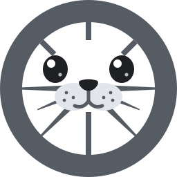
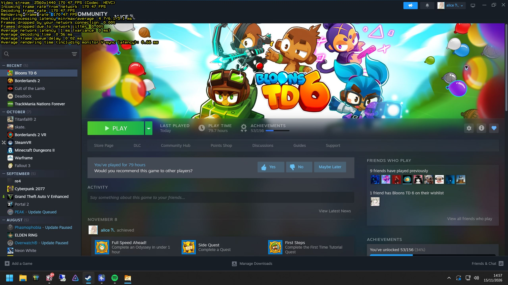

<p align="center">
  
</p>

<h1 align="center">Norilight</h1>

<p align="center"><em>The cutest Moonlight client ε(　꜆´ω`)꜆ for desktop users and gamers alike.</em></p>

<p align="center">
  <a href="https://github.com/azijnwater/Norilight/releases/tag/nightly"><strong>Download nightly</strong></a> ·
  <a href="#whats-inside">What's inside</a> ·
  <a href="#updating">Updating</a> ·
  <a href="BUILDING.md">Build from source</a>
</p>

Norilight streams games and desktops from your PC, just like
[Moonlight](https://github.com/moonlight-stream/moonlight-qt), the client it's forked from.
It adds **profiles** so one app works for both gaming and desktop work: each profile
keeps its own streaming settings and the monitor it opens on. Streams open in their own
windows, and the main window stays open beside them.

It works with [Sunshine](https://github.com/LizardByte/Sunshine),
[Apollo](https://github.com/ClassicOldSong/Apollo) and older NVIDIA GameStream hosts.
A few extras need Apollo on the host; they're marked below.

<table>
  <tr>
    <td width="50%"><a href="docs/screenshots/apps.png"></a><br><strong>App library</strong>: apps and running streams in one window.</td>
    <td width="50%"><a href="docs/screenshots/profiles.png"></a><br><strong>Profiles</strong>: a separate setup for each way you stream.</td>
  </tr>
  <tr>
    <td><a href="docs/screenshots/settings.png"></a><br><strong>Settings</strong>: searchable, with an explanation beside each control.</td>
    <td><a href="docs/screenshots/streaming.png"></a><br><strong>Streaming</strong>: a desktop stream with compact performance stats.</td>
  </tr>
</table>

## Getting started

1. **Install.** Download from the [nightly release](https://github.com/azijnwater/Norilight/releases/tag/nightly):
   - **Windows x64:** run the `-Setup.exe`. To skip installing, extract the ZIP and run `Norilight.exe` instead.
   - **macOS (Apple Silicon and Intel):** open the DMG and drag Norilight to Applications.
     Nightlies are unsigned, so right-click the app and choose **Open** the first time.
     Allow Local Network access when asked, or Norilight can't find your PC.
2. **Pick a starting profile.** On first launch, Norilight asks how you'll use it:

   | Starting point | What it sets up |
   | --- | --- |
   | **Gaming** | Fullscreen, V-Sync and frame pacing off, mouse captured. Frame rate follows your main display (60–240 FPS). |
   | **Work and desktop** | Borderless fullscreen at 60 FPS, V-Sync on, direct mouse control, and a cursor that can leave the stream. |
   | **Standard** | Norilight's defaults, ready to customise. |
   | **Existing settings** | Keep your current settings, copy the active profile, or import Moonlight's settings if they're on this PC. Moonlight's own settings are left untouched. |

3. **Pair with your host.** Your PC appears automatically on most networks. If it
   doesn't, add it by IP address with the **+** button.

## What's inside

### Profiles, monitors and streams

- **One profile per use.** Each profile keeps its own streaming settings and target
  monitor. Create, copy, rename and switch profiles from the toolbar or
  **Settings > Profiles**. Language is shared across all of them.
- **Choose where a stream opens.** Target a specific monitor or the one the main window
  is on. Resolution and frame rate can match that monitor when the stream starts. If a
  profile's monitor is unplugged, the profile stays saved and becomes available again
  when the monitor returns.
- **Several streams at once.** Pick an app, then a profile, and the stream opens in its
  own window. The **Streams** bar in the main window lists your sessions, so you can stop
  running ones or restart ended ones. How many connections work at once depends on the
  host; separate windows don't give you separate host desktops.

### Desktop and input

- The cursor can move freely between the stream and your other windows and monitors.
- Always-on-top, remembered window placement, and a watch-only mode.
- Adjustable mouse and scroll speed, plus an optional local cursor over the stream.
- **Windows:** **Take screenshots on this PC only** keeps PrtScn and Win+Shift+S local,
  so your own capture tool (ShareX included) handles them.
- Controller deadzones, stick scrolling in mouse mode, and switches for motion sensors
  and touchpad input.

### Picture and performance

- Fit, Fill or Stretch the picture, with optional top alignment.
- Type an exact bitrate, and request full-range colour.
- Compact performance stats, and an optional latency summary when a stream ends.

### Apollo extras

These need [Apollo](https://github.com/ClassicOldSong/Apollo) on the host.

- Virtual displays that match the client, with a resolution scale (needs SudoVDA on the host).
- Text clipboard sync, with an option to keep host text out of Windows clipboard history.
- Run host server commands during a stream with Ctrl+Alt+Shift+R.

## Updating

Norilight checks for a newer nightly each time it starts. When one is available, an
update button appears in the toolbar. Click it and choose **Install and restart**:

- **Windows (installed):** Norilight downloads the new installer, checks it, and installs
  it over the current version. Windows asks for permission, then Norilight reopens by itself.
- **Windows (ZIP):** Norilight downloads the new ZIP and replaces its own files once it has
  closed, keeping your portable settings, then reopens.
- **macOS:** Norilight downloads the new DMG and replaces the app in place, then reopens.
  If it can't write to the app's folder, it opens the DMG so you can drag the app over yourself.

Settings live in your user profile (or next to `Norilight.exe` for the ZIP), so updates
keep them. Uninstalling on Windows also leaves them in place.

The version shown in Norilight (top right of Settings, or `Norilight --version`) is the
nightly's name, such as `nightly-20261115-0f4841b`: the build date and commit, matching
the release and its file names.

New nightlies are built daily at 20:17 Europe/Amsterdam time, when `main` has changed.
They are unsigned pre-releases. Builds you compile yourself don't check for updates.

## Shortcuts while streaming

The most useful ones are below. **Settings > Shortcuts** lists every keyboard and controller shortcut.

| Shortcut | What it does |
| --- | --- |
| Ctrl+Alt+Shift+Q | End the stream |
| Ctrl+Alt+Shift+Z | Release or recapture the mouse and keyboard |
| Ctrl+Alt+Shift+X | Switch between fullscreen and windowed |
| Ctrl+Alt+Shift+L | Keep the cursor inside the stream window, or let it out |
| Ctrl+Alt+Shift+K | Send system keys to the host, or keep them on this PC |
| Ctrl+Alt+Shift+V | Type this PC's clipboard text into the host |
| Ctrl+Alt+Shift+S | Show or hide performance stats |
| Ctrl+Alt+Shift+R | List Apollo server commands (1–9 runs one, Esc closes) |

## Roadmap

Planned, not available yet:

- **Norishine integration**, so the host and client work together more closely.
- **Host configuration from the client**, so you visit the host's settings less often.
- **Automatic hardware and network tuning** to help pick good streaming settings.

Existing Sunshine hosts and Moonlight-compatible setups will keep working.

## Building

Clone with submodules. Norilight uses its own fork of `moonlight-common-c`, which adds
Apollo server commands.

```sh
git clone --recursive https://github.com/azijnwater/Norilight.git
```

Then follow [BUILDING.md](BUILDING.md) for Windows x64 or macOS. The nightly workflow only
packages those two platforms. Linux and other upstream targets keep Moonlight's build code
but aren't built or tested here; see the [upstream build notes](docs/MOONLIGHT-README.md#building).

## Credits and license

Norilight builds on [Moonlight PC](https://github.com/moonlight-stream/moonlight-qt) and the
Moonlight Game Streaming Project. Several additions follow
[Artemis](https://github.com/ClassicOldSong/moonlight-android), with host extensions from
[Apollo](https://github.com/ClassicOldSong/Apollo). Thanks also to Qt, SDL, FFmpeg, Opus,
[moonlight-common-c](https://github.com/moonlight-stream/moonlight-common-c),
[QMdnsEngine](https://github.com/cgutman/qmdnsengine) and
[SDL_GameControllerDB](https://github.com/gabomdq/SDL_GameControllerDB).
The [original Moonlight README](docs/MOONLIGHT-README.md) is kept in this repository.

Norilight is licensed under the GNU General Public License v3, like Moonlight. See
[LICENSE](LICENSE). Bundled dependencies keep their own licenses.
