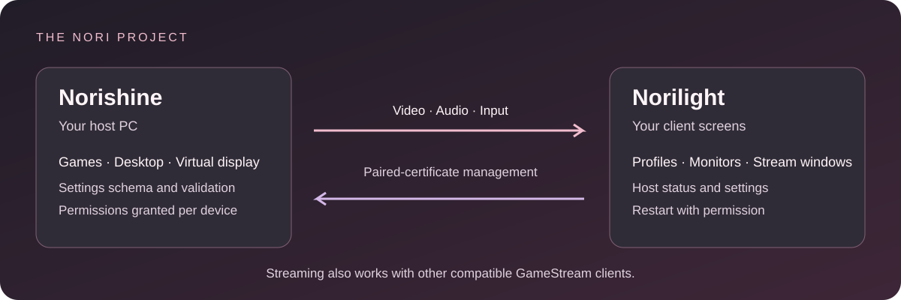
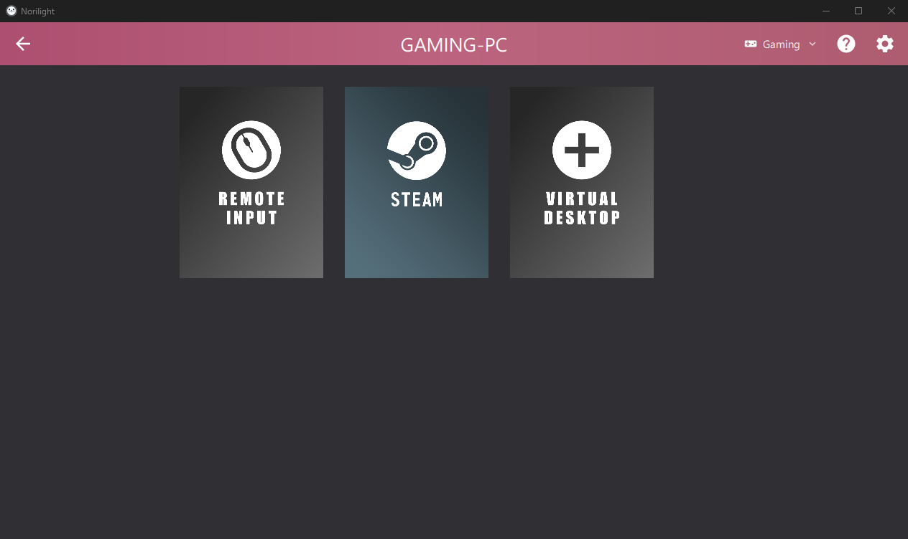
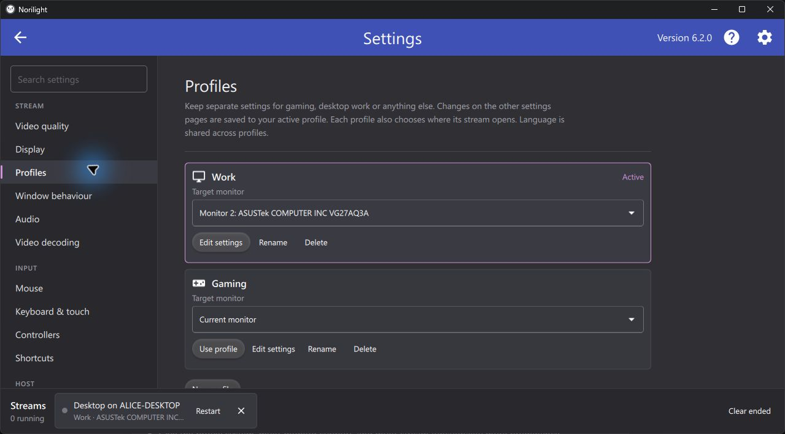
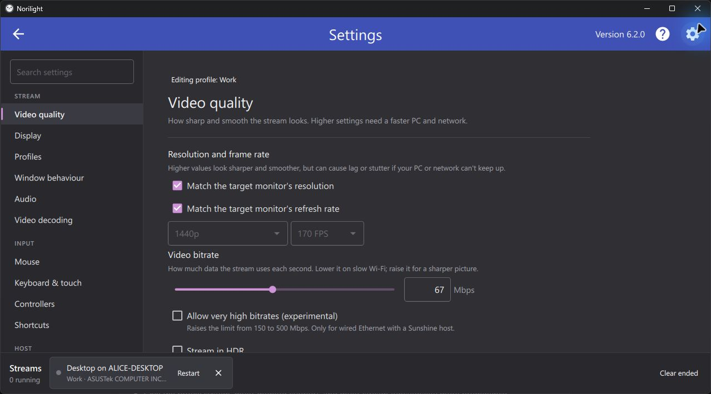
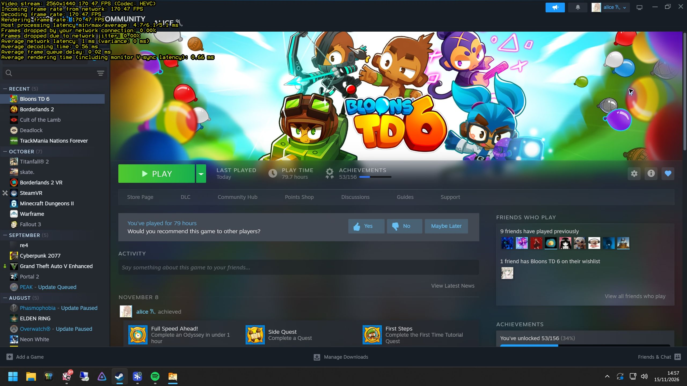
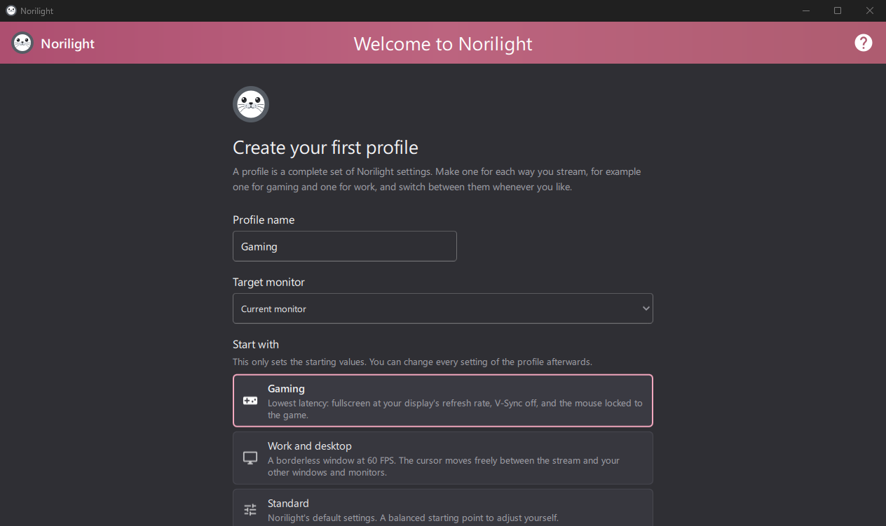
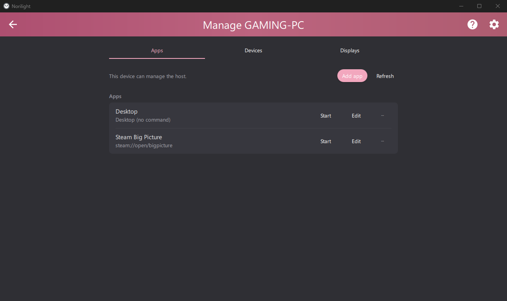
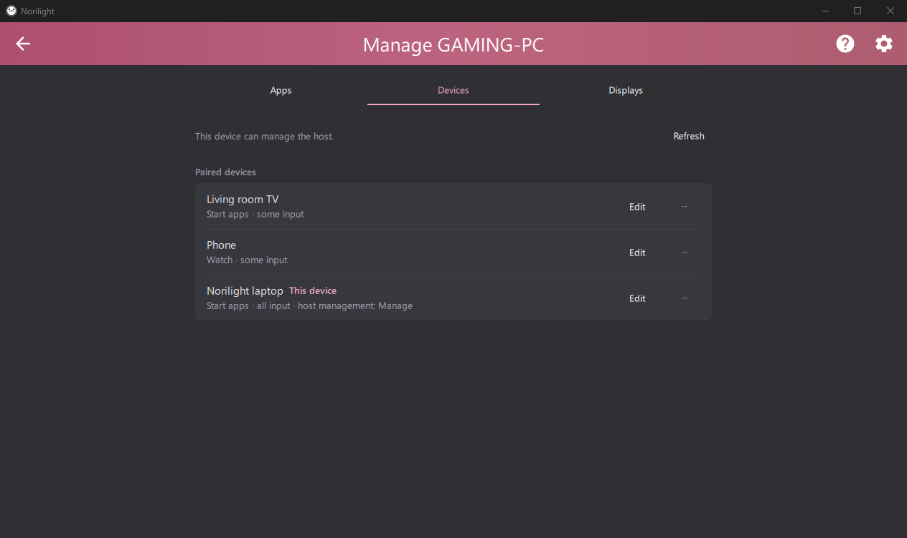
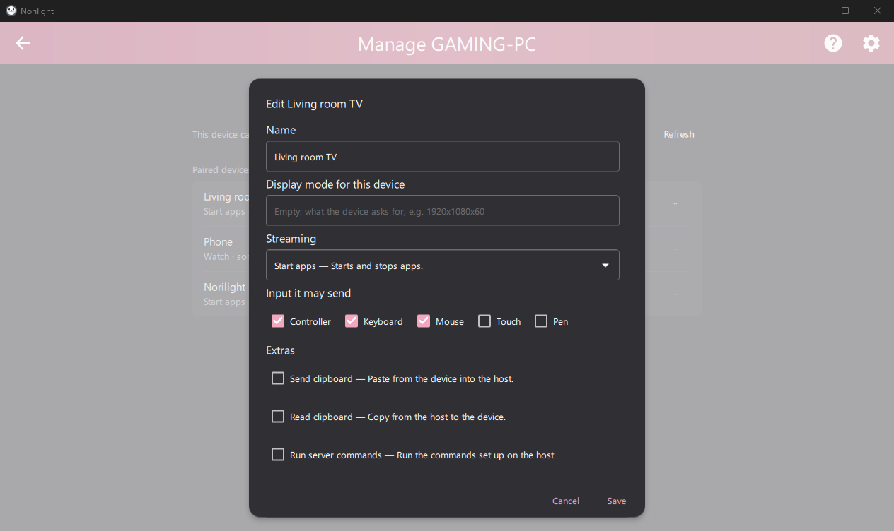

# What's in Norilight

## Profiles, monitors and streams

- **One profile per use.** Each profile keeps its own streaming settings and target
  monitor. Create, copy, rename and switch profiles from the toolbar or
  **Settings > Profiles**. Language is shared across all of them.
- **Choose where a stream opens.** Target a specific monitor or the one the main window
  is on. Resolution and frame rate can match that monitor when the stream starts. If a
  profile's monitor is unplugged, the profile stays saved and works again when the
  monitor returns.
- **Several streams at once.** Pick an app, then a profile, and the stream opens in its
  own window. The **Streams** bar in the main window lists your sessions, so you can stop
  running ones or restart ended ones. How many connections work at once depends on the
  host; separate windows don't give you separate host desktops.

## Desktop and input

- The cursor can move freely between the stream and your other windows and monitors.
- Always-on-top, remembered window placement, and a watch-only mode.
- Adjustable mouse and scroll speed, plus an optional local cursor over the stream.
- **Windows:** **Take screenshots on this PC only** keeps PrtScn and Win+Shift+S local,
  so your own capture tool (ShareX included) handles them.
- Controller deadzones, stick scrolling in mouse mode, and switches for motion sensors
  and touchpad input.

## Picture and performance

- Fit, Fill or Stretch the picture, with optional top alignment.
- Type an exact bitrate, and request full-range colour.
- Compact performance stats, and an optional latency summary when a stream ends.

## Apollo and Norishine extras

These need [Apollo](https://github.com/ClassicOldSong/Apollo) or
[Norishine](https://github.com/Nori-Oppi/Norishine) on the host.

- Virtual displays that match the client, with a resolution scale (needs SudoVDA on the host).
- Text clipboard sync, with an option to keep host text out of Windows clipboard history.
- Run host server commands during a stream with Ctrl+Alt+Shift+R.

## Managing a Norishine host

These need [Norishine](https://github.com/Nori-Oppi/Norishine) on the host, and permission
for this device in its web UI (see the [guide](GUIDE.md#managing-a-norishine-host)).

- **Host Settings:** the host's status, and its settings to search and change. The host
  checks every value and marks the ones it rejects. Restart the host from the same page.
- **Manage Host:** add, edit, reorder, start, close and remove apps; rename paired devices,
  change their permissions and display mode, end their streams or unpair them; see the
  displays and pick the one to stream.
- A device can't change its own permissions. Settings with lists or scripts, such as app
  commands, are changed in the host's web UI.

## Screenshots

| | |
| --- | --- |
|  |  |
| **App library**: a host's apps, with cover art. | **Profiles**: a separate setup for each way you stream. |
|  |  |
| **Settings**: searchable, with an explanation beside each control. | **Streaming**: a desktop stream with compact stats. |
|  |  |
| **First start**: pick a starting point for your first profile. | **Manage Host**: a Norishine host's apps. |
|  |  |
| **Paired devices**: what each may do, and its stream. | **Device permissions**: the same choices as the host's web UI. |

## Credits

Norilight builds on [Moonlight PC](https://github.com/moonlight-stream/moonlight-qt) and the
Moonlight Game Streaming Project. Several additions follow
[Artemis](https://github.com/ClassicOldSong/moonlight-android), with host extensions from
[Apollo](https://github.com/ClassicOldSong/Apollo). Thanks also to Qt, SDL, FFmpeg, Opus,
[moonlight-common-c](https://github.com/moonlight-stream/moonlight-common-c),
[QMdnsEngine](https://github.com/cgutman/qmdnsengine) and
[SDL_GameControllerDB](https://github.com/gabomdq/SDL_GameControllerDB).
The [original Moonlight README](MOONLIGHT-README.md) is kept in this repository.
Bundled dependencies keep their own licenses.
